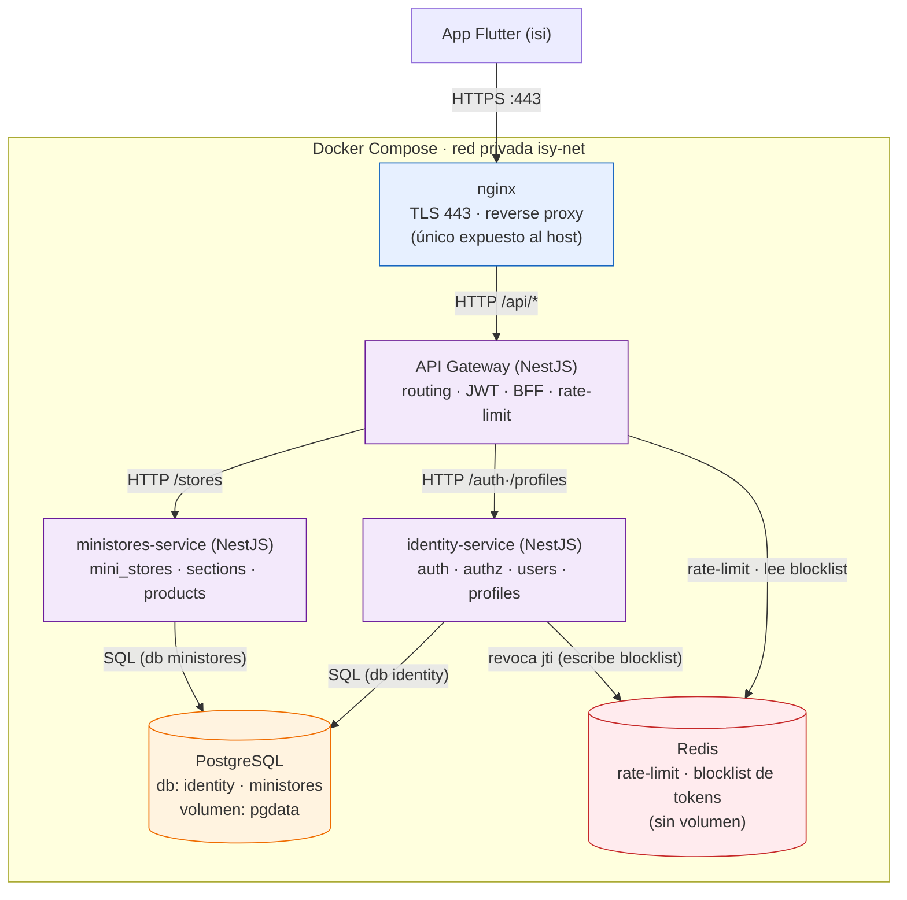
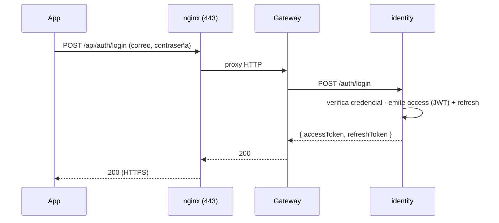
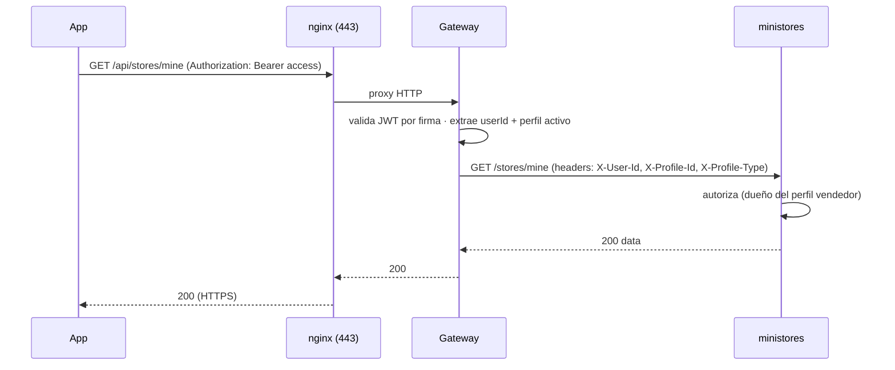

# Diseño — Arquitectura Backend de Isy

## 1. Visión general

Arquitectura de **microservicios** en **NestJS**, orquestada con **Docker Compose**, expuesta
al exterior por **nginx** (TLS en 443) a través de un **API Gateway**. Persistencia en
**PostgreSQL** (una instancia, un volumen, una base de datos por servicio).

```
App Flutter ──HTTPS:443──► nginx ──HTTP──► API Gateway ──HTTP──► microservicios ──► PostgreSQL
                                              │
                                              └──► Redis (rate-limit · blocklist de tokens)
```

El objetivo de esta fase es el **esqueleto end-to-end** con dos microservicios: **identity**
y **ministores**.

---

## 2. Decisiones clave (tus preguntas, resueltas)

### 2.1 ¿Auth y usuarios en el mismo microservicio? → Sí, y además los perfiles

**Recomendación:** un solo microservicio **`identity`** que concentra **auth + autorización +
usuarios + perfiles**. Razones:

- Son **un mismo bounded context**. En el módulo de BD ya reverse-engineereado, `users`,
  `auth_identities`, `email_verification_codes`, `password_reset_tokens`, `user_sessions`
  (y `profiles`) forman una sola unidad cohesiva.
- **Evita transacciones distribuidas**: registrar un usuario crea la cuenta + su identidad de
  contraseña + perfil comprador + (OTP). Si auth y users estuvieran separados, eso sería una
  saga/2PC innecesaria en esta etapa.
- **Evita chattiness**: cada login/validación necesita datos del usuario. Tenerlos juntos
  elimina llamadas cruzadas constantes.
- Los **perfiles** van aquí también porque el *perfil activo* conduce la **autorización** y el
  tema de la app; se necesita en casi todas las peticiones. Separarlo obligaría a una llamada
  extra por request.

> Regla aplicada: **no sobre-descomponer**. Empezamos con un servicio de identidad coarse y lo
> partimos solo si aparece una costura clara o necesidad de escala.

### 2.2 ¿El segundo servicio se llama "mini tiendas" o "perfiles"? → Mini Tiendas

**Recomendación:** **`ministores`** (Mini Tiendas), **no** "perfiles".

- "Perfiles" **no** debe ser un servicio aparte: pertenecen a `identity` (ver 2.1).
- Mini Tiendas es su **propio dominio de comercio/catálogo** (`mini_stores`, `store_sections`,
  `store_products`). Referencia al **perfil vendedor por ID** (propiedad de identity), sin FK
  entre bases de datos de servicios distintos.

### 2.3 ¿El API Gateway es otro microservicio? ¿Cómo se implementa?

- **Es un servicio desplegable (un proceso), pero NO un microservicio de dominio.** Es un
  componente de **borde/orquestación**: no posee datos de negocio. Su trabajo es ser la
  **fachada** de la aplicación.
- **Cómo se implementa aquí:** una **app NestJS dedicada** (`apps/gateway`). Recibe el HTTP de
  los clientes y:
  - **Enruta** a cada microservicio según la ruta.
  - **Valida el JWT** (firma/exp) y propaga el contexto de identidad.
  - Aplica **CORS, validación, rate limiting, logging/correlación**.
  - Opcionalmente **agrega** respuestas de varios servicios (patrón **BFF**).
- **Transporte gateway ↔ servicios:** empezamos con **HTTP/REST interno** (simple de depurar y
  exponer). Más adelante se puede migrar a un transporte de `@nestjs/microservices`
  (TCP/NATS/RabbitMQ) o introducir un **bus de eventos** para flujos asíncronos.

> Alternativa considerada: un gateway "de producto" (Kong/KrakenD/Traefik). Para un stack Nest
> y un equipo que está aprendiendo, **un gateway en Nest** da más control (auth/BFF) y menos
> piezas nuevas. Se puede cambiar luego.

### 2.4 ¿Dónde encaja nginx vs el gateway? (todo por 443)

Son **dos capas distintas**, complementarias:

| Capa | Pieza | Responsabilidad |
|---|---|---|
| **Borde** | **nginx** | Termina **TLS** en 443, redirige 80→443, reverse proxy, headers de seguridad, gzip, (rate-limit de borde). **Único expuesto al host.** |
| **Aplicación** | **API Gateway (Nest)** | Enrutamiento a microservicios, **auth JWT**, validación, agregación/BFF, formato de error unificado. |

**La cadena para que todo entre por 443:**

```
Cliente ──HTTPS:443──► nginx ──(HTTP, red interna)──► API Gateway ──(HTTP)──► microservicios
```

- El cliente **solo** conoce `https://<host>:443`.
- nginx proxya todo lo que va bajo `/api/` hacia el gateway (`gateway:3000`) por la red privada.
- El gateway habla con `identity:3001` y `ministores:3002` por la red privada.
- **Solo nginx publica un puerto** (443, y 80 para redirección). Gateway, servicios y Postgres
  **no publican puertos** al host.

> ¿Se podría usar solo nginx (sin gateway)? Sí, nginx puede enrutar por ruta directo a cada
> servicio. Pero entonces las preocupaciones de aplicación (auth JWT, agregación, contrato
> único) se dispersan. Como quieres un gateway, usamos **nginx (borde) + gateway (aplicación)**.

### 2.5 Persistencia: una Postgres, una base de datos por servicio, un volumen

- **Una** instancia de PostgreSQL (un contenedor) con **un único volumen** (`pgdata`).
- Dentro, **una base de datos por microservicio** (decisión **confirmada**; descartado
  *schema-por-servicio*): `identity`, `ministores`. Cada servicio se conecta solo a la suya;
  **sin FK entre servicios** (se referencian por ID a nivel de app).
- Da aislamiento lógico ahora y permite **mover una BD a su propia instancia** después sin
  tocar el dominio.

### 2.6 Estructura de código: monorepo de proyectos independientes

- El repositorio es un **monorepo** (un solo repo) que agrupa los proyectos, pero **cada
  microservicio es un proyecto NestJS independiente** con su **propia metadata**: `package.json`
  (con su pin de **Volta** a Node 24), `tsconfig`, `node_modules`, `Dockerfile` y build propios.
  **No comparten** `package.json` ni dependencias.
- **Código compartido** (DTOs/contratos, guards JWT): se resolverá cuando exista, como un
  **paquete compartido** (workspace o paquete versionado) o por duplicación controlada. En el
  esqueleto todavía no hay código compartido.

### 2.7 Redis (caché / estado efímero) — parte del núcleo

Se incorpora **Redis** desde el inicio como almacén **en memoria** para dos necesidades del
borde/identidad:
- **Rate limiting** distribuido (contadores atómicos con TTL), compartido entre instancias del
  gateway.
- **Blocklist de access tokens** (`jti` revocados con TTL = vida restante), para **revocación
  inmediata** pese a que el JWT es *stateless*.

**No lleva volumen**: su contenido es efímero y reconstruible (coherente con "solo la BD
persiste"). Si Redis se reinicia, los contadores de rate-limit se reinician y la blocklist se
vacía (los tokens revocados volverían a ser válidos solo hasta su corta caducidad). A futuro el
mismo Redis habilita el **chat en vivo** (pub/sub + presencia).

---

## 3. Diagrama de arquitectura (componentes)



Solo `nginx` publica puertos al host (443/80). Solo `postgres` tiene volumen.

---

## 4. Flujo de peticiones

### 4.1 Login (emisión de tokens)


### 4.2 Petición autenticada a otro servicio


> El access token se valida por **firma** en el gateway (sin tocar BD). El refresh token solo
> se usa contra `identity` para renovar (ver módulo de BD de usuarios).

---

## 5. Topología Docker Compose

| Servicio | Imagen/base | Puerto host | Puerto interno | Volumen | Notas |
|---|---|---|---|---|---|
| `nginx` | nginx:alpine | **443**, 80 | 443/80 | — | TLS + reverse proxy; único expuesto |
| `gateway` | node (Nest) | — | 3000 | — | fachada de aplicación |
| `identity` | node (Nest) | — | 3001 | — | auth · users · profiles |
| `ministores` | node (Nest) | — | 3002 | — | tiendas · secciones · productos |
| `postgres` | postgres:16 | — | 5432 | **pgdata** | dbs: identity, ministores |
| `redis` | redis:7-alpine | — | 6379 | — | rate-limit · blocklist (sin estado durable) |

Red privada: `isy-net` (bridge). Dependencias: gateway depende de identity/ministores/redis;
servicios dependen de postgres (y identity de redis), con health checks.

**Esqueleto conceptual** (se detalla en tasks):
```yaml
services:
  nginx:
    image: nginx:alpine
    ports: ["443:443", "80:80"]
    depends_on: [gateway]
    networks: [isy-net]
  gateway:
    build: { context: ., dockerfile: apps/gateway/Dockerfile }
    environment: [ ... JWT_PUBLIC_KEY, IDENTITY_URL, MINISTORES_URL, REDIS_URL ]
    depends_on: [identity, ministores, redis]
    networks: [isy-net]          # sin "ports"
  identity:
    build: { context: ., dockerfile: apps/identity/Dockerfile }
    environment: [ DATABASE_URL=postgres://.../identity, JWT_PRIVATE_KEY, REDIS_URL ]
    depends_on:
      postgres: { condition: service_healthy }
      redis: { condition: service_healthy }
    networks: [isy-net]
  ministores:
    build: { context: ., dockerfile: apps/ministores/Dockerfile }
    environment: [ DATABASE_URL=postgres://.../ministores ]
    depends_on: { postgres: { condition: service_healthy } }
    networks: [isy-net]
  postgres:
    image: postgres:16
    volumes: ["pgdata:/var/lib/postgresql/data"]
    healthcheck: { test: ["CMD-SHELL", "pg_isready"] }
    networks: [isy-net]          # sin "ports" (salvo dev)
  redis:
    image: redis:7-alpine
    healthcheck: { test: ["CMD", "redis-cli", "ping"] }
    networks: [isy-net]          # sin "ports" ni volumen (estado efímero)
volumes: { pgdata: {} }           # único volumen: la BD
networks: { isy-net: {} }
```

> Las dos bases (`identity`, `ministores`) se crean al iniciar Postgres mediante un script de
> init en `/docker-entrypoint-initdb.d/`.

---

## 6. Componentes en detalle

### nginx (borde)
- Termina **TLS** (certificados montados; en dev, autofirmados; en prod, Let's Encrypt/el CA).
- `server` en 443; `location /api/ { proxy_pass http://gateway:3000/; }`.
- Redirección 80 → 443. Headers de seguridad (HSTS, X-Content-Type-Options…), gzip.
- (Opcional) servir web estática o assets en el futuro.

### API Gateway (NestJS, `apps/gateway`)
- Módulos: enrutamiento a servicios (clientes HTTP), `AuthGuard` (valida JWT por clave
  pública), `RateLimit`, `CorrelationId` (middleware), filtro de errores unificado, CORS.
- Mapeo de rutas → servicios (ejemplos):
  - `/api/auth/*`, `/api/profiles/*` → `identity`
  - `/api/stores/*`, `/api/products/*` → `ministores`
- Propaga contexto por headers firmados/internos: `X-User-Id`, `X-Profile-Id`,
  `X-Profile-Type`, `X-Correlation-Id`.

### identity-service (NestJS, `apps/identity`)
- Dominio: auth (password + SSO), OTP, reset, sesiones/refresh, **users**, **profiles**.
- Emite access (JWT firmado con clave privada) + refresh (opaco, hash en BD).
- BD: base `identity`. Migraciones propias.

### ministores-service (NestJS, `apps/ministores`)
- Dominio: `mini_stores`, `store_sections`, `store_products`.
- Referencia `seller_profile_id` (de identity) por ID; autoriza por contexto del gateway.
- BD: base `ministores`. Migraciones propias.

### PostgreSQL
- Una instancia, volumen `pgdata`. Bases: `identity`, `ministores`. Un usuario/rol por base
  (mínimo privilegio) recomendado.

### Redis
- Almacén **en memoria**, **sin volumen** (estado efímero). Usado por:
  - **gateway**: rate-limiting (contadores con TTL) y lectura de la **blocklist** de `jti` en
    cada petición protegida.
  - **identity**: escribe en la **blocklist** al revocar (logout, "cerrar en todos los
    dispositivos", cambio de contraseña), con TTL = vida restante del access.
- `healthcheck` con `redis-cli ping`. A futuro: pub/sub para chat en vivo.

---

## 7. Seguridad

- **TLS solo en el borde (nginx/443)**; tráfico interno por la red privada de Docker.
- **Servicios y gateway no publican puertos** al host (reduce superficie de ataque).
- **JWT**: access firmado con par de claves (identity firma con privada; gateway valida con
  pública). Refresh opaco + hash en BD (ya definido en el módulo de usuarios).
- **Secretos por variables de entorno / archivos de secreto** (nunca en el repo). `.env` para
  dev; gestor de secretos en prod.
- **Mínimo privilegio en BD**: cada servicio con su usuario y su base.
- Autorización por **tipo de perfil activo** (comprador/vendedor/servicios) y, a futuro, RBAC.
- **Revocación inmediata de access tokens:** como el access es *stateless*, para invalidarlo
  antes de su caducidad se usa una **blocklist** de `jti` en **Redis** (parte del núcleo): el
  gateway la consulta en cada petición protegida e `identity` escribe en ella al revocar
  (logout, "cerrar en todos los dispositivos", cambio de contraseña). El refresh se revoca en
  BD (`user_sessions.revoked_at`).

### 7.1 Seguridad del cliente (app móvil Flutter)

Principios para la app, asumiendo que **el binario puede ser inspeccionado/descompilado**:

- **TLS + SSL/Certificate Pinning:** fijar la **clave pública (SPKI)** del certificado del
  servidor para frustrar MITM aun con una CA comprometida. Usar **pines de respaldo** y un plan
  de **rotación** (idealmente actualizables por configuración remota) para no romper la app al
  renovar certificados.
- **Nada de secretos en el binario:** la app solo usa **claves públicas/publishable**. Las
  claves secretas (JWT privada, secreto de la pasarela) viven **solo** en el backend.
- **Almacenamiento seguro:** refresh token y datos sensibles en **Keychain (iOS) / Keystore o
  EncryptedSharedPreferences (Android)** vía `flutter_secure_storage`; el access token en
  memoria. Nunca en almacenamiento plano.
- **Ofuscación y endurecimiento:** capa Dart con `flutter build --obfuscate
  --split-debug-info`; en **Android**, además **R8/ProGuard** con `minifyEnabled true` +
  `shrinkResources true` (ofusca y reduce la capa nativa Kotlin/Java); en iOS, símbolos
  *stripped* en release. Sin logs verbosos ni errores detallados en release.
- **Atestación de app/dispositivo:** **Play Integrity (Android)** y **App Attest/DeviceCheck
  (iOS)** para validar que la app es genuina y el dispositivo no está manipulado,
  especialmente **antes de operaciones de pago**.
- **Dispositivos comprometidos:** en **Android**, **bloquear por completo** la ejecución de la
  app si se detecta **root** (pantalla de bloqueo, sin permitir continuar — no solo advertir).
  En **iOS**, aplicar lo equivalente ante **jailbreak**. La detección local se complementa con
  **atestación** (Play Integrity / App Attest), más robusta y difícil de evadir que la
  detección en el dispositivo.
- **Protección de pantalla:** `FLAG_SECURE` (Android) y ocultar en el *app switcher* (iOS) en
  pantallas sensibles; evitar copiar datos sensibles al portapapeles.
- **Biometría / re-autenticación local** para acciones sensibles (gestionar medios de pago,
  confirmar pago, cambiar seguridad).
- **Sesión:** access corto + rotación de refresh (ya diseñado); **logout limpia el secure
  storage**; auto-bloqueo al pasar a segundo plano.
- **Deep links verificados** (App Links/Universal Links); cuidado con **WebViews** (JS
  restringido, validar orígenes, sin *bridges* nativos innecesarios) — relevante para 3DS.
- **Permisos mínimos** del SO; dependencias/SDKs **auditados y fijados** a versión.
- **El servidor nunca confía en el cliente:** precios, autorización y estado de pago se
  **revalidan en el backend**.

### 7.2 Pagos con SDK de tercero

El proveedor entrega un **SDK** (integración menos formal que un banco directo). Principios:

- **Reducir el alcance PCI-DSS:** los **datos de tarjeta (PAN/CVV) nunca** tocan tu app ni tu
  backend. Se usan los **hosted fields y la tokenización del SDK**, de modo que la tarjeta
  viaja **del SDK directo al proveedor**. Tu backend guarda **solo un token/referencia de
  pago**, nunca el número de tarjeta.
- **Claves:** en el cliente solo la **publishable key**; la **secret key** vive en el backend
  (gestor de secretos, rotable).
- **Servidor autoritativo:** el **monto y la orden se calculan en el backend**; jamás se confía
  en el importe enviado por el cliente. El backend crea el *payment intent*.
- **No confiar en el "pago exitoso" del cliente:** confirmar vía **webhooks firmados** del
  proveedor (verificar firma) y/o su API. El estado del pago es **autoritativo en el servidor**.
- **Idempotencia:** claves de idempotencia al crear cobros para evitar **cargos duplicados**.
- **3D Secure / SCA:** soportar el flujo del SDK (WebView/redirect) de forma segura.
- **Atestación antes de pagar** + señales de **fraude** del proveedor (device fingerprint,
  velocity checks).
- **Auditoría y conciliación:** registrar eventos de pago (sin datos de tarjeta) y conciliar
  contra el proveedor.
- **Microservicio `payments` (futuro):** aísla los cobros, habla con el proveedor por la secret
  key, procesa webhooks, maneja idempotencia y guarda **referencias** de pago. La app llega a
  él vía el gateway; los datos de tarjeta **no** pasan por él (van SDK→proveedor).

---

## 8. Estructura del repositorio

```
Isy/                         # monorepo (un repo agrupa todo)
├── backend/                 # microservicios NestJS INDEPENDIENTES (cada uno su metadata)
│   ├── gateway/             #   package.json (Volta node 24) · tsconfig · node_modules · Dockerfile
│   │   └── src/             #   main.ts · app.module.ts · health.controller.ts
│   ├── identity/            #   (ídem, proyecto independiente)
│   └── ministores/          #   (ídem, proyecto independiente)
├── mobile/                  # app Flutter (paquete isy)
├── infra/
│   ├── nginx/               # nginx.conf, certs (dev)
│   └── postgres/            # init.sql (crea dbs identity/ministores)
├── docker-compose.yml       # solo nginx expuesto (443/80)
├── .env.example
└── README.md
```

> Código compartido entre servicios (contratos/guards): a futuro como **paquete compartido**
> (workspace o versionado) o duplicación; hoy cada servicio es autocontenido.

---

## 9. Configuración y entornos

- **Variables de entorno** por servicio (validadas con `libs/config`): `DATABASE_URL`,
  `JWT_PRIVATE_KEY`/`JWT_PUBLIC_KEY`, `ACCESS_TTL`, `REFRESH_TTL`, URLs internas
  (`IDENTITY_URL`, `MINISTORES_URL`), `PORT`.
- `.env.example` versionado (sin secretos reales); `.env` local ignorado por git.
- Perfiles de entorno: `dev` (certs autofirmados, hot-reload) y `prod` (imágenes optimizadas,
  certs reales, sin puertos de BD expuestos).

---

## 10. Roadmap de servicios (fuera del alcance inicial)

| Servicio futuro | Dominio |
|---|---|
| `social` / `feed` | publicaciones, reacciones, comentarios, follows |
| `chat` | conversaciones y mensajes (tiempo real con **Redis** pub/sub) |
| `notifications` | push/email, OTP delivery |
| `media` | subida y servido de imágenes (logo/portada/productos) |
| `payments` | pasarela vía **SDK de tercero**: tokenización, *payment intents*, webhooks firmados, idempotencia (los datos de tarjeta nunca tocan el servidor) |
| **bus de eventos** | NATS/RabbitMQ para flujos asíncronos (ej. "producto publicado" → feed) |

> **Redis ya es parte del núcleo** (rate-limiting + blocklist de tokens); el chat en vivo
> reutilizará esa misma instancia (pub/sub + presencia).

Cada uno entra como nuevo `app/` + rutas nuevas en el gateway, sin romper el contrato del
cliente.

---

## 11. Decisiones

### Confirmadas
- **Persistencia:** una Postgres, un volumen (`pgdata`), **una base de datos por servicio**
  (`identity`, `ministores`). Descartado *schema-por-servicio*. Lo demás, sin estado.
- **Redis (parte del núcleo):** almacén en memoria **sin volumen**. Se usa para **rate
  limiting** distribuido y la **blocklist de access tokens** (revocación inmediata):
  - *Rate limiting:* contadores atómicos con TTL compartidos entre instancias del gateway
    (ej. 5 intentos de login/min por cuenta/IP).
  - *Blocklist:* el access (JWT) se valida por firma sin tocar BD; guardando los `jti`
    revocados en Redis (TTL = vida restante del token), el gateway los rechaza al instante
    ("cerrar sesión en todos los dispositivos" / baneo sin esperar al TTL).
  - El mismo Redis habilitará el **chat en vivo** (pub/sub + presencia) más adelante.

### Abiertas (a refinar)
- **Transporte gateway ↔ servicios**: empezamos con HTTP/REST; evaluar `@nestjs/microservices`
  (TCP) o broker cuando haya flujos asíncronos.
- **Gestión de certificados** en prod (Let's Encrypt + companion, o terminación en un LB externo).
- **Media / almacenamiento de imágenes**: objeto S3-compatible (ej. MinIO) — **no** en el
  volumen de la BD.

### Propuesta a futuro — resiliencia de Redis
- **Política ante caída de Redis (recomendación):**
  - *Rate limiting* → **fail-open** (no bloquear usuarios si Redis cae) + alerta/monitoreo.
  - *Blocklist de tokens* → **fail-open** en endpoints normales (la corta vida del access acota
    el riesgo), pero **fail-closed** en operaciones críticas (pagos, cambio de correo/contraseña,
    cierre de sesión global).
  - Mitigar la caída con **Redis en alta disponibilidad** (réplica + Sentinel, o Redis
    gestionado) para que el escenario sea raro.
- **Durabilidad de la blocklist (recomendación):** mantener **efímero (sin volumen)** por ahora.
  Si la revocación debe **sobrevivir reinicios**, habilitar **AOF** (`appendonly`) — lo que
  implicaría un **volumen pequeño exclusivo para Redis** (excepción puntual a "solo la BD
  persiste"), o usar un Redis gestionado con persistencia.
