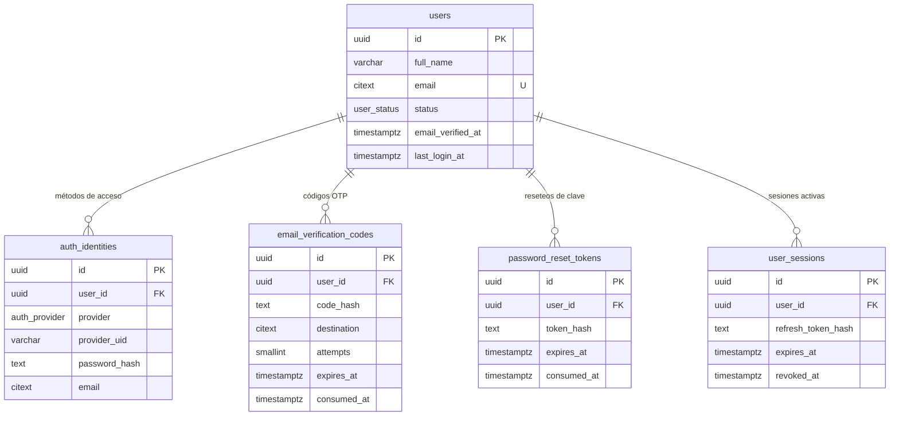

# Diseño de base de datos — Isy (PostgreSQL)

Ingeniería inversa de los mocks, **módulo por módulo**, para una BD **relacional
(PostgreSQL 14+)**. Este documento es de diseño: muestra qué tablas salen de cada pantalla,
su estructura y cómo se relacionan (sin scripts de creación).

> **Convenciones**
> - Llaves primarias `uuid`.
> - Fechas en `timestamptz` (UTC).
> - **Auditoría en TODAS las tablas:** `created_at`, `created_by`, `updated_at`, `updated_by`.
>   Los `*_at` son `timestamptz`; los `*_by` son `uuid → users(id)` (nulos si la acción la hace el sistema).
> - Correos como `citext` (sin distinción de mayúsculas).
> - Secretos (contraseñas, códigos OTP, tokens) se guardan **hasheados**, nunca en claro.
> - Leyenda de llaves: **PK** primaria · **FK** foránea · **U** única · **IX** índice.

---

## Módulo 1 — Usuarios y Autenticación

Derivado de las pantallas **Registro**, **Verificación OTP** y **Login**.

### 1.1 De dónde sale cada tabla

| Pantalla | Tabla(s) que origina |
|---|---|
| Registro tradicional | `users` + `auth_identities` (contraseña) |
| Botones SSO (Apple / Google) | `auth_identities` (identidad externa) |
| Verificación OTP | `email_verification_codes` |
| Login | `user_sessions` (+ lectura de `users`/`auth_identities`) |
| ¿Olvidaste tu contraseña? | `password_reset_tokens` |

**Idea central:** la *cuenta* (`users`) se separa de la *forma de entrar*
(`auth_identities`). Así una misma persona puede tener contraseña **y** Apple **y** Google
sobre la misma cuenta, y agregar proveedores sin tocar `users`. Quien entra solo con SSO no
tiene contraseña (sin columnas vacías en `users`).

### 1.2 Diagrama entidad-relación



### 1.3 Estructura de las tablas

> Las 4 columnas de **auditoría** (`created_at`, `created_by`, `updated_at`, `updated_by`)
> aparecen al final de cada tabla. El diagrama ER de arriba las omite por legibilidad.

#### `users` — cuenta raíz (la persona)
| Columna | Tipo | Llave | Nulo | Descripción |
|---|---|---|---|---|
| id | uuid | PK | no | Identificador de la cuenta |
| full_name | varchar(120) | | no | Campo **Nombre** del registro |
| email | citext | U | no | Campo **Correo**; único, sin distinción de mayúsculas |
| avatar_url | text | | sí | Avatar opcional |
| status | enum `user_status` | | no | `pending_verification` → `active` tras OTP |
| email_verified_at | timestamptz | | sí | Momento en que se verificó el correo |
| last_login_at | timestamptz | | sí | Se actualiza en cada login |
| created_at | timestamptz | | no | Fecha de creación |
| created_by | uuid | FK→`users` | sí | Quién creó el registro |
| updated_at | timestamptz | | no | Fecha de última modificación |
| updated_by | uuid | FK→`users` | sí | Quién modificó por última vez |

> `user_status`: `pending_verification` · `active` · `suspended` · `deleted`
> Futuro (módulo Perfiles): `last_active_profile_id → profiles(id)` para recordar el último
> perfil activo al iniciar sesión.

#### `auth_identities` — métodos de acceso (contraseña + SSO)
| Columna | Tipo | Llave | Nulo | Descripción |
|---|---|---|---|---|
| id | uuid | PK | no | |
| user_id | uuid | FK→`users`, IX | no | Dueño de la identidad (borrado en cascada) |
| provider | enum `auth_provider` | U(user_id,provider) | no | `password` · `google` · `apple` |
| provider_uid | varchar(255) | U(provider,provider_uid) | sí | `sub`/ID del proveedor SSO; **null** en contraseña |
| password_hash | text | | sí | bcrypt/argon2; **solo** en `password` |
| email | citext | | sí | Correo que devuelve el proveedor |
| created_at | timestamptz | | no | Fecha de creación |
| created_by | uuid | FK→`users` | sí | Quién creó el registro |
| updated_at | timestamptz | | no | Fecha de última modificación |
| updated_by | uuid | FK→`users` | sí | Quién modificó por última vez |

> **Reglas:** máx. un método por proveedor por usuario (`U(user_id, provider)`); una identidad
> SSO no se comparte entre cuentas (`U(provider, provider_uid)`). Una fila `password` lleva
> `password_hash` y `provider_uid` nulo; una fila SSO lleva `provider_uid` y `password_hash` nulo.

#### `email_verification_codes` — códigos OTP (pantalla de verificación)
| Columna | Tipo | Llave | Nulo | Descripción |
|---|---|---|---|---|
| id | uuid | PK | no | |
| user_id | uuid | FK→`users`, IX | no | A quién pertenece el código |
| purpose | enum `verification_purpose` | | no | `signup` (default), `login`, `email_change` |
| code_hash | text | | no | **Hash** del código de 6 dígitos (nunca en claro) |
| destination | citext | | no | Correo al que se envió |
| attempts | smallint | | no | Intentos fallidos (default 0) |
| max_attempts | smallint | | no | Tope de intentos (default 5) |
| expires_at | timestamptz | | no | **created_at + 15 min** (es el contador de la UI) |
| consumed_at | timestamptz | | sí | Al verificar o al invalidar por reenvío |
| created_at | timestamptz | | no | Fecha de creación |
| created_by | uuid | FK→`users` | sí | Quién creó el registro |
| updated_at | timestamptz | | no | Fecha de última modificación |
| updated_by | uuid | FK→`users` | sí | Quién modificó por última vez |

> **Un solo código vivo** por `user_id`+`purpose` (índice único parcial sobre
> `consumed_at IS NULL`): al **solicitar de nuevo**, el código anterior se marca consumido y se
> inserta uno nuevo (reinicia los 15 min).

#### `password_reset_tokens` — recuperación de contraseña
| Columna | Tipo | Llave | Nulo | Descripción |
|---|---|---|---|---|
| id | uuid | PK | no | |
| user_id | uuid | FK→`users`, IX | no | |
| token_hash | text | U | no | Hash del token enviado por correo |
| expires_at | timestamptz | | no | Vigencia corta (p. ej. 1 h) |
| consumed_at | timestamptz | | sí | Al usarse |
| created_at | timestamptz | | no | Fecha de creación |
| created_by | uuid | FK→`users` | sí | Quién creó el registro |
| updated_at | timestamptz | | no | Fecha de última modificación |
| updated_by | uuid | FK→`users` | sí | Quién modificó por última vez |

#### `user_sessions` — sesiones / "seguir conectado"
| Columna | Tipo | Llave | Nulo | Descripción |
|---|---|---|---|---|
| id | uuid | PK | no | |
| user_id | uuid | FK→`users`, IX | no | |
| refresh_token_hash | text | U | no | Hash del refresh token |
| user_agent | text | | sí | Dispositivo/navegador |
| ip_address | inet | | sí | IP de origen |
| last_used_at | timestamptz | | sí | Último uso |
| expires_at | timestamptz | | no | Caducidad (p. ej. 30 días) |
| revoked_at | timestamptz | | sí | Cierre de sesión / revocación |
| created_at | timestamptz | | no | Fecha de creación |
| created_by | uuid | FK→`users` | sí | Quién creó el registro |
| updated_at | timestamptz | | no | Fecha de última modificación |
| updated_by | uuid | FK→`users` | sí | Quién modificó por última vez |

### 1.4 Mapeo pantalla → columna

**Registro**
| Campo UI | Destino |
|---|---|
| Nombre | `users.full_name` |
| Correo | `users.email` |
| Contraseña | `auth_identities.password_hash` (provider = `password`) |
| Confirmar contraseña | no se persiste (validación de cliente) |
| Continuar con Apple | `auth_identities(provider='apple', provider_uid, email)` |
| Continuar con Google | `auth_identities(provider='google', provider_uid, email)` |

**Verificación OTP**
| Elemento UI | Destino |
|---|---|
| Código de 6 dígitos | `email_verification_codes.code_hash` |
| Correo destino | `email_verification_codes.destination` |
| Contador 15:00 | `email_verification_codes.expires_at` |
| Verificar OK | `users.email_verified_at`, `users.status='active'`, `consumed_at` |
| Intentos | `email_verification_codes.attempts` |
| Solicitar de nuevo | nueva fila (invalida la anterior) |

**Login**
| Elemento UI | Destino |
|---|---|
| Correo + contraseña | lee `users` por email; verifica hash en `auth_identities` |
| Entrada exitosa | `users.last_login_at` + nueva fila en `user_sessions` |
| Apple / Google | lee `auth_identities(provider, provider_uid)` |
| ¿Olvidaste tu contraseña? | `password_reset_tokens` |

### 1.5 Flujos (descriptivos)

**Registro + OTP**
1. Se crea la cuenta en `users` con `status = pending_verification`.
2. Se crea su identidad de contraseña en `auth_identities`.
3. Se genera un OTP, se guarda su hash en `email_verification_codes` (vence en 15 min) y se
   envía por correo.
4. El usuario ingresa el código: se valida contra el hash si no expiró y no superó intentos.
   Al acertar → se marca `consumed_at`, y la cuenta pasa a `active` con `email_verified_at`.
5. **Reenviar:** se consume el código anterior y se inserta uno nuevo (contador a 15:00).

**SSO (Apple/Google)**
- Se busca la identidad por `(provider, provider_uid)`. Si existe → login. Si no → se crea
  `users` (ya verificado, porque el proveedor validó el correo) + la identidad SSO.

**Login con contraseña**
- Se busca `users` por correo y se verifica el hash de la identidad `password`. Al acertar se
  actualiza `last_login_at` y se abre una sesión en `user_sessions`.

### 1.6 Política de sesión y tokens (access vs refresh)

**El access token NO se almacena en la base.** Es de vida corta (15–60 min) y stateless
(JWT firmado): el backend lo valida por **firma**, sin consultar la BD. Persistirlo añadiría
E/S por request y superficie de ataque sin beneficio. Por eso `user_sessions` guarda **solo el
hash del refresh token** — y así debe ser.

**¿Dónde vive cada token?**

| Token | Vigencia típica | Dónde se guarda (cliente) | Qué guarda el servidor |
|---|---|---|---|
| Access token | 15–60 min | memoria (o secure storage) | **nada** (se valida por firma) |
| Refresh token | 30–60 días (deslizante) + tope absoluto | secure storage del SO (Keychain/Keystore) | **solo el hash** en `user_sessions` |

**Ciclo de vida**
1. Login/registro → el servidor emite access + refresh; guarda el **hash** del refresh en
   `user_sessions` (con `expires_at`, `last_used_at`).
2. El access caduca → el cliente pide refresco con su refresh token → nuevo par de tokens
   (**refresco silencioso**, el usuario no ve login).
3. **Rotación:** en cada refresco se reemplaza el `refresh_token_hash` y se actualiza
   `last_used_at` (vigencia deslizante). Presentar un refresh viejo = posible robo → se
   marca `revoked_at` de la sesión.
4. **Cerrar sesión / revocar** (incluye "cerrar en todos los dispositivos", cambio de
   contraseña): se setea `revoked_at`.

**Revocación del access token:** como no se guarda, se "mata" dejándolo caducar (por eso es
corto). Si se necesitara revocación inmediata, se usaría una lista de bloqueo por `jti`
(id del token) — pero aun así **no** se almacena el token completo.

> Nota: para detección de reuso más robusta se puede agregar a futuro un `session_family_id`
> que agrupe los refresh tokens rotados de una misma sesión. No es necesario para el MVP.

### 1.7 Pendiente para próximos módulos
- **Perfiles** (`profiles`: comprador/vendedor/servicios con `user_id`) y luego
  `users.last_active_profile_id`.
- **Publicaciones, reacciones, comentarios, chat y follows** en iteraciones siguientes.


---

> **Mini Tiendas** — módulo de BD (vitrina del perfil vendedor). Vista navegable en
> `db-mini-tiendas.html`. Todas las tablas llevan auditoría (`created_at`, `created_by`,
> `updated_at`, `updated_by`).

## Módulo 2 — Mini Tiendas

Vitrina del **perfil vendedor**. Se relaciona con `profiles` mediante
`mini_stores.seller_profile_id → profiles.id` (la tabla `profiles` es del módulo **Perfiles**,
aún por detallar; aquí documentamos únicamente la relación).

### Relación con `profiles`
```
profiles (perfil vendedor)  1 ──── 0..1  mini_stores
mini_stores                 1 ──── *     store_sections
mini_stores                 1 ──── *     store_products
store_sections              1 ──── *     store_products   (section_id, opcional)
```

#### `mini_stores`
| Columna | Tipo | Llave | Nulo | Descripción |
|---|---|---|---|---|
| id | uuid | PK | no | |
| seller_profile_id | uuid | FK→`profiles`, U | no | Una tienda por perfil vendedor |
| name | varchar(80) | | no | |
| tagline | varchar(120) | | sí | Eslogan |
| description | text | | sí | |
| category | varchar(60) | | no | Giro |
| cover_url | text | | sí | Foto de portada (banner; "biografía") |
| logo_url | text | | sí | Foto de perfil (logo de la tienda) |
| accent_color | char(7) | | no | Hex, ej. `#EF6C00` |
| is_open | bool | | no | Abierto/cerrado (default true) |
| schedule | varchar(120) | | sí | Horario |
| zone | varchar(120) | | sí | Zona/cobertura |
| delivery_options | delivery_option[] | | no | Arreglo (pickup/delivery/shipping) |
| payment_methods | payment_method[] | | no | Arreglo (cash/transfer/card) |

> delivery/payments como arrays de enum (alternativa: tablas puente). + auditoría.

#### `store_sections`
| Columna | Tipo | Llave | Nulo | Descripción |
|---|---|---|---|---|
| id | uuid | PK | no | |
| store_id | uuid | FK→`mini_stores`, IX | no | ON DELETE CASCADE |
| name | varchar(60) | | no | Ej. "Del día", "Bebidas" |
| position | int | | no | Orden en la vitrina (reordenable) |

> + auditoría.

#### `store_products`
| Columna | Tipo | Llave | Nulo | Descripción |
|---|---|---|---|---|
| id | uuid | PK | no | |
| store_id | uuid | FK→`mini_stores`, IX | no | ON DELETE CASCADE |
| section_id | uuid | FK→`store_sections` | sí | ON DELETE SET NULL |
| name | varchar(100) | | no | |
| description | text | | sí | |
| price | numeric(12,2) | | no | |
| offer_price | numeric(12,2) | | sí | CHECK < price |
| unit | varchar(24) | | no | pieza, kg, docena, manojo… |
| image_url | text | | sí | |
| stock | enum `stock_status` | | no | available / sold_out / made_to_order |
| is_featured | bool | | no | Destacado (default false) |
| status | enum `product_status` | | no | Borrador o Publicado; publicado aparece también en el Feed de publicaciones (default `draft`) |
| published_at | timestamptz | | sí | Momento en que se publicó |
| tags | text[] | | sí | Etiquetas (alternativa: tabla puente) |

> + auditoría.

---

### Enumerados (Mini Tiendas)
`stock_status` (available, sold_out, made_to_order) · `delivery_option` (pickup, delivery,
shipping) · `payment_method` (cash, transfer, card) · `product_status` (draft, published).
